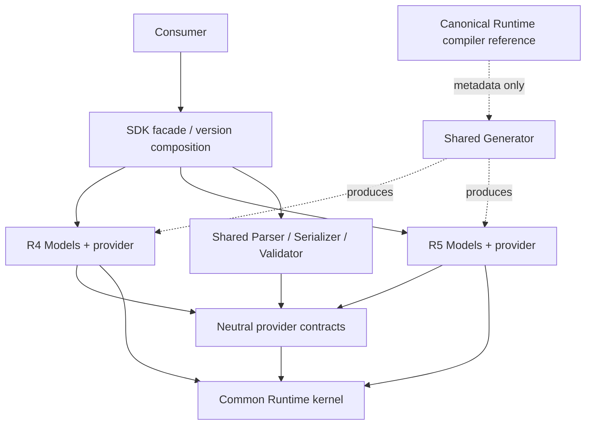

# ADR：MyFhirSdk FHIR R4／R5 多版本支援

Version 0.1 — 2026-10-13

- 狀態：Draft；依使用者討論方向提出，production 實作尚未開始。
- 目標版本：R4 `4.0.1` 與 R5 `5.0.0`；R4B 不包含在本階段範圍。
- 決策責任：Architecture、Runtime、Models、Serialization、Validation、CodeGen、Compatibility 維護者。
- 實作及證據：[Implementation Guide](MyFhirSdk_FHIR_R4_Support_Implementation_Guide.md)、[Acceptance Criteria](MyFhirSdk_FHIR_R4_Support_Acceptance_Criteria.md)。

## 1. Context

K0–K7 已將最小 Runtime kernel 抽出。現有 production assemblies 為 `MyFhirSdk.dll` 與
`MyFhirSdk.Runtime.dll`；完整 Models／engines／Client／IG physical split 尚未交付。
歷史決策見 [Kernel ADR](../gen/MyFhirSdk_Runtime_Kernel_Extraction_ADR.md)、
[Acceptance Decision](../gen/MyFhirSdk_Runtime_Kernel_Extraction_Acceptance_Decision.md) 與
[Handoff register](../gen/MyFhirSdk_Runtime_Kernel_Extraction_Handoff.md#4-後續工作-register)。

目前的 R5 耦合包含：

| 區域 | 現有實作與影響 |
| --- | --- |
| Generator | `ModelIrBuilder`、manifest、metadata／validation renderers 與 composition validator 固定 R5 路徑／名稱；policy 與 descriptor 僅接受目前的精確版本組合 |
| Engines | 預設建構使用 `R5ModelMetadataProvider.Default`／`PrimitiveRegistry.Default`；provider 契約與注入入口為 internal |
| Primitive composition | `PrimitiveRegistry` 的 generated partial 與 SDK 共編譯；registry 拒絕重複 FHIR primitive 名稱 |
| Models | generated R5 declarations、handwritten `SimpleQuantity`、metadata／factory／validation composition 仍由 SDK 編譯 |
| Runtime | `Meta`、`Narrative`、`Extension` 是已接受的 bootstrap contract，不能未驗證就視為所有版本的完整共通模型 |
| Client | Search API 直接使用目前 R5 `Bundle`，default validator 與 resolver 也需版本化 |

加入 package input 不代表已支援該版本的公開 API、JSON、validation 或 Client。

## 2. 範圍與能力分層

本階段保留同一 repository，新增 R4，同一程序能同時使用 R4／R5，不透過全域版本開關互相切換。
官方 R4 `4.0.1` 與 core package 身分見 [官方下載頁](https://hl7.org/fhir/R4/downloads.html)。

| 交付層級 | 完成內容 |
| --- | --- |
| 基礎 SDK | 固定輸入生成 R4 primitives／datatypes／resources，metadata／factory，Parser／Serializer 及明確列出的 validation 能力；R5 regression 保持 |
| R4 Client | R4 resources／Bundle／OperationOutcome、版本相符的 engines 與 HTTP 操作；受控 HTTP 與外部 server 證據分開 |
| R4 IG | 指定 IG package／version／FHIR base／rules 與獨立驗收；不由 R4 core 自動取得 |

V5 完成只能宣稱基礎 SDK 能力；R4 Client 需 V6，IG 需另案。R4／R5 資料互轉、完整
FHIR conformance、通用 constraint Profile generation、全面補齊 deferred validation、TFM 升級
及公開 NuGet release 不包含在這次基礎支援中。

## 3. Proposed decisions

### 3.1 共用 Generator，版本設定與產物獨立

沿用一個 tool 與共用 package loading、IR、rendering、manifest／provenance、驗證 pipeline。
每個 release configuration 明確提供 package identity／hash、FHIR version、policies、CLR mapping、
輸出路徑、composition 名稱及相容的 Runtime contract。

R4／R5 使用各自的 registry、metadata、factory、rules 與 manifests。相同 canonical URL 或
FHIR 型別名稱可能出現在兩個版本，cache／lookup key 必須包含版本 context，不能只用名稱共用。
輸出批次包含 namespace／destination contract，不只 package 身分；錯誤組合在寫檔前拒絕。

保留 exact compatibility policy，新增經測試的精確組合，不能把 `4.x` 或任意 package 放行。
現行 tool `1.2.0` 沒有 R4 支援；新 tool、schema、policy 與 descriptor 版本由 V4 根據契約變更決定。
Runtime API 未變更時不必為 R4 人為重建 reference；若 compiler contract 改變，需原子更新
canonical reference、descriptor、matrix、manifests 與 snapshots。

保留 installed tool 的 metadata-only 邊界：不引用完整 SDK／Models implementation project，
不搜尋 repository／bin／obj，不以 assembly scan 補齊 metadata，也不新增隱含網路下載。
compiler reference 只供生成／編譯驗證；執行時部署 Runtime implementation。

### 3.2 Models 分版本，既有 R5 source API 優先保留

目標建立 `MyFhirSdk.R4.Models`、`MyFhirSdk.R5.Models` 獨立 assembly；名稱為規劃名稱，V0 固定。
建議保留 R5 既有公開 namespace／member shape，R4 採明確版本 namespace，以支援同時引用。
兩個版本的 Models 都不能依賴 engines 或 SDK facade。

搬移 R5 declaration 會改變 defining assembly／AQN，即使 namespace 不變也要盤點 reflection、
DI、設定字串與所有 consumers／相依 DLL。延續全面重編、不提供 type forwarders 的策略；
不宣稱舊 binary 直接置換相容。任何 R5 source API 變更須記錄原因、遷移與測試，不能以重編掩蓋。

`SimpleQuantity` 各版本的來源、base type、使用位置與 API 必須盤點。保留必要的手寫 auxiliary
asset 是可接受的過渡方式，但要有版本／hash／compile ownership；不得直接沿用 R5 型別或退回
`Quantity` 而改變公開 API。通用 constraint generator 可延後。

### 3.3 Engines 使用明確版本 context

Engine 指 Parser、Serializer、Validator。共用處理流程，由不可變的版本 context 提供
FHIR／package identity、model metadata／factory、primitive definitions／codecs、validation rules
及能力清單。API 名稱由 V2 固定，這裡不先宣告已存在的 `FhirContext` 類別。

Context 的各元件必須屬於同一版本，建立時驗證一致性；registry/cache 必須依 context 隔離。
不把兩套同名 primitive wrappers 合併至現有單一 registry。相同 CLR／JSON 行為的 codec 可共用，
不同版本的支援集合與註冊由各自 provider 決定。

Parser 由呼叫端指定 context；`resourceType: Patient` 或缺少 version 的 `meta.profile` 不能作為
可靠的自動判版依據。Serializer／Validator 檢查物件與 context 相符；巢狀 resource、datatype、
primitive、open type 及 Extension 同樣受檢查。誤用不得靜默依另一版本規則解讀。

保留既有 R5 default constructors／facade 行為。新增 R4 入口必須明確，不能把 default 改成 R4。
只公開跨 assembly 必要的 SPI；不要直接公開整個 internal registry、所有 IR 或實作類別。
獨立 engines assembly 可依相依關係需要建立；Parser／Serializer／Validator 不必各自一個 DLL。

### 3.4 Runtime 共用方案須先通過實驗

優先維持單一共用 Runtime。V1 對照 R4／R5 base hierarchy、primitive accessor、
`Meta`／`Narrative`／`Extension`、contained resources 與 open types，確認 shape、JSON 與 validation。
例如 `Meta.Tag`／`Security` 接受 `DataType`，需定義如何拒絕另一版本的 `Coding`。

如現有 bootstrap 無法表達必要差異，記錄具體失敗案例，先調整契約與依賴方案再擴大生成；
不得讓 Runtime 反向依賴某個 Models assembly。需要新增 contracts assembly 時，只放中立契約，
不能引用 R4／R5 concrete model；public member shape 與 reference 的變更需另有明確遷移。

### 3.5 目標依賴方向

下圖是邏輯責任與允許的依賴，不代表每個框都必須成為獨立 DLL。中立 contracts 可位於 Runtime
或獨立小型 assembly，V2 固定 ownership。Models 指向該契約，engines 也只透過契約取得版本資訊。

禁止 Runtime／contracts → concrete Models、Models → SDK／engines 的反向相依。Engines 不能
直接引用 R5 provider；facade／版本 composition 負責把 provider 交給 engines。
Client 可以先保留在 SDK，但 R4 Client 的型別、resolver、Bundle 及錯誤回應解析要版本相符。

## 4. 替代方案與取捨

| 方案 | 評估 |
| --- | --- |
| 複製 R4 repository／Generator／SDK | 修正與 policy 會重複維護，不採用 |
| 只換 input package，沿用 R5 composition | 無法保證型別、JSON 與規則相符，不採用 |
| 全域 static current version | 同程序並行 R4／R5 容易互相污染，不採用 |
| 先拆所有 Client／IG／engines packages | 擴大前置工作；先完成需要的契約與 Models 邊界 |
| 所有 FHIR Models 都版本化 namespace | 結構一致但造成 R5 source migration；V0 如採用須明確記錄並驗證 |

維持同 repository 有利原子變更與完整測試，但會增加生成檔與 CI 成本。透過明確 compile items、
版本 job、共用 harness、固定 input 與忽略 build artifacts 控制成本；拆 repository 留待獨立團隊／發布需求。

## 5. V0／V1 必須收斂的決策

| 決策 | 建議與證據要求 |
| --- | --- |
| R4／R5 namespace、assembly 與 facade | 採 §3.2 建議，列完整 compile ownership 與 consumer migration |
| Context／SPI owner 與公開 API | 最小必要 contract，包含所有 signature 的連帶型別與 deps；API snapshot 固定 |
| Runtime bootstrap 相容性 | R4／R5 selected closure 的實驗結果；不可相容時先提出契約修訂 |
| Constraints／SimpleQuantity | 各版本使用清單、asset provenance、禁止重複 declaration |
| R4 policy 與能力範圍 | 固定官方輸入，supported／unsupported／deferred 清單 |
| 輸入與生成檔提交 | 容量盤點、可重現取得與 CI clean generation，不依賴開發者 cache |

未完成的項目保留 Draft／pending，不能填入尚未量測的 hash、檔案數、factory 數或 test counts。
