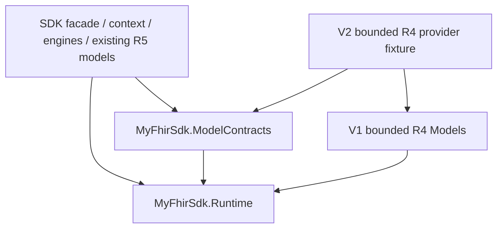

# V2 — 正式 context 與中立 SPI

日期：2026-10-14。V1 已由使用者確認提交、push 並通過 CI。V2 在同一 feature branch 接續，
尚未提交或執行新 CI；本目錄保存 V2 本機驗證證據，不宣稱完整 production R4 支援。

## 實作與 ownership

- `MyFhirSdk.ModelContracts.dll` 只依賴 Runtime，擁有不可變 `ModelIdentity`、metadata/factory DTO、
  primitive codec/validator、validation node/issue/rule signatures，以及 capabilities。
- `MyFhirSdk.ModelMetadata.FhirModelContext` 在 SDK 擁有 engines adapters；建構時檢查 release、package、
  package version、policy、model identity 一致，複製 provider inventories 並檢查其 CLR 型別範圍。
- Parser／Serializer／Validator 新增 public context constructor。無參數 constructor 經
  `R5ModelContext.Default` 組裝，保留既有 R5 模型與 JSON／validation 行為。
- resource factory 使用明確 metadata；R5 model inventory 追蹤既有 metadata 與宣告的 CLR properties，
  不以 assembly scan 發現額外 resource factories。
- 正式 engines 檢查 root、nested、contained、Meta.Tag／Security、Extension datatype／primitive 的
  exact CLR identities。空的外來 Coding 也會拒絕，修正 V1 所記錄的 silent omission／late lookup 問題。
- serializer 與 validator 對同一混用圖提供相同 `FhirSdkException`，訊息含
  `FHIR_MODEL_OWNERSHIP`、context 版本、CLR 型別及位置；不修改輸入物件。
- context 不提供全域 current version；版本 metadata／rules／primitive registry 各自組裝。
  共用 JSON reflection cache 只以 CLR `Type` 為 key，不快取版本選擇。



SPI／API snapshots：

- [Neutral SPI 與 Runtime signature dependencies](../../../../Tests/Architecture/ApprovedModelContractsApi.txt)
- [SDK runtime API](../../../../Tests/Architecture/ApprovedPublicApi.txt)：只新增 context／R5 composition 入口與三個 context constructors。
- [R5 Models API](../../../../Tests/Architecture/ApprovedR5ModelApi.txt)：維持 V1 基線。

## 獨立 provider 驗收

`Tests/FhirVersions/V2/Provider/MyFhirSdk.R4.V2.Provider.csproj` 只引用 ModelContracts 與 V1 R4 Models，
不引用 SDK／engines。`eng/Export-FhirV2ProviderFixture.py` 把固定的 V1 bounded composition 轉為
中立契約，並產生 test-only primitive implementations；來源與 hashes 記於 `fixture-manifest.json`。
這些 copies 用於證明 SPI 能在 SDK 外實作，未加入正式 generator 或公開 R4 package。

Provider inventories 不可經公開列表修改；codec、validator、factory、rule callbacks 是版本 provider
所擁有的執行邏輯，必須 stateless 或支援並行。Context 不會對任意第三方 callback 的內部狀態作深拷貝。
R4 scope 沿用 V1 Patient／Observation／Attachment dependency closure；能力不包含完整 resource set、
FHIRPath invariants 或 profile validation。原有 IG API／診斷仍由 SDK 擁有，未搬入中立 SPI。

## 驗證與重現

G2 執行結果見 [summary.json](summary.json)，逐項案例見 [v2-test-cases.json](v2-test-cases.json)。
本機 review 修正後結果：31 項 V2 cases 通過（原有 21 項加上 10 項 review regression cases）；
完整 solution 972 通過、0 失敗、1 項 external Client smoke 跳過；13 項 Python 完整性測試通過，
K3 的 8 個 gates 與 20 項 failure-mode harness checks 通過。
K3 消費端驗證見 [consumer-rebuild-summary.json](consumer-rebuild-summary.json)，包括 Runtime／ModelContracts
缺檔拒絕與 isolated deployment；可攜檔案 hashes 見 [evidence-files.json](evidence-files.json)。
舊 V0／V1 baseline evidence 保持不變；V1 的歷史 gap 描述對應當時 revision，V2 已修正其行為。

```powershell
dotnet restore MyFhirSdk.sln
python eng/Export-FhirV2ProviderFixture.py --check
python eng/Test-FhirV2Context.py --output artifacts/fhir-versions/v2/run
pwsh -NoProfile -File eng/Test-KernelConsumerRebuildHarness.ps1 -OutputDirectory artifacts/fhir-versions/v2/harness
pwsh -NoProfile -File eng/Test-KernelConsumerRebuild.ps1 -OutputDirectory artifacts/fhir-versions/v2/consumers
```

需要 pinned .NET SDK 9.0.317、Python 3.10+、PowerShell 7.2+。本機沿用 ignored project-local pwsh 7.5.0。
完整測試只允許 endpoint 未設定時跳過指定 Client external smoke；不將它視為已驗證的外部整合。
G2 同時核對所有實際測試 DLL 與量測的 Release bytes，以及未變更的 Runtime compiler reference。
新增 CI 在 Windows／Ubuntu 執行 G2；既有 K3／fresh-generated SDK jobs 也會驗證新的 dependency graph。

本機修正後原始證據位於 `artifacts/fhir-versions/v2/review-fixed/` 與 `review-fixed-k3/`。
開發期間的失敗 run 保留於 ignored artifacts：初次 K3 的 API 盤點未傳入新 Contracts 相依，
初次 G2 runner 的最低案例數誤設 22；功能回歸全部通過，但 gate 正確保留 Failed。
後者修正為 21 並要求指定 SPI snapshot case 必須存在；最終證據來自新的完整 run。

## Code review 修正

- Ownership guard 優先按 `FhirObject` 檢查 CLR identity；實作 `IEnumerable` 的 resource 不能以空集合
  繞過 root／contained 檢查。已註冊的 enumerable 模型仍以 FHIR properties 巡訪，nullable scalar 不誤判為 list。
- Context 建立時要求 `Meta.tag` 與 `Meta.security` 均指向該版本 `valueCoding` parser target，
  缺少任一映射、映射到 Quantity 或兩欄位不一致均明確拒絕。
- Ownership guard 與 validator 共用 readable-property 規則，包含 `[JsonIgnore]` 欄位及列表。
  JSON 仍略過這些欄位；context ownership 與 validation 不因 JSON visibility 而省略。
- 新增 10 項 cases 驗證兩個版本的 enumerable root／contained、五種缺漏／錯誤 Meta mappings、
  ignored scalar／list 的 foreign primitive、以及已註冊 enumerable 模型的 nested ownership。
  G2 runner 固定要求這四組 review cases 與 SPI snapshot 都必須出現在實際 TRX。

## 後續工作

V3 分離 R5 Models 與 generated composition，依這次契約把版本 providers 移出 SDK；
engines physical assembly 是否分離依 V3 dependency graph 決定。V4 建立正式版本 policies／CLI config，
再由 V5 交付完整 R4 models/provider。V2 沒有改變 Runtime public API、canonical compiler reference、
production generator 支援版本或 Client 的預設 R5 API。
