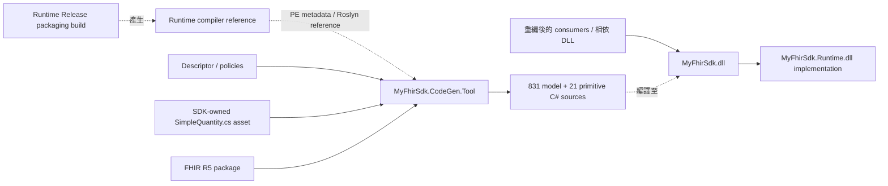

# MyFhirSdk Runtime kernel extraction handoff

Version 1.0

- 範圍：K0–K7 的最小 Runtime kernel physical extraction。
- 使用者已確認 K0–K6 合併 main；K6 push CI 通過。K7 文件／source rollback 本機證據見下方，K7 PR／CI 另行驗收。
- K6 合併後基準：`64267f05c335361c6e1a3c5abac0423421ffe690`。
- 決策：[ADR](MyFhirSdk_Runtime_Kernel_Extraction_ADR.md)、[Acceptance](MyFhirSdk_Runtime_Kernel_Extraction_Acceptance_Decision.md)。
- 操作：[Migration 與 rollback](MyFhirSdk_Runtime_Kernel_Extraction_Operations.md)、[CodeGen README](../../CodeGen/README.md)。

## 1. 交付架構

CodeGen production project 沒有 SDK／Runtime ProjectReference。圖中的 compiler reference 是
build-time metadata asset；SDK 部署使用 Runtime implementation，不能以 reference assembly 取代。
目前只有兩個 SDK 執行 assembly，沒有獨立 Models、Parser、Serializer、Validation、Client 或 IG package。

| Owner / compile output | 目前內容 |
| --- | --- |
| Runtime maintainers / `MyFhirSdk.Runtime.dll` | `FhirObject`、`IFhirExtensionValue`、`Base`、`Element`、`BackboneElement`、`BackboneType`、`DataType`、`PrimitiveType<T>`、`Resource`、`DomainResource`、`Extension`、`Meta`、`Narrative`、`IPrimitiveValueAccessor`，共 14 declarations |
| SDK + CodeGen maintainers / `MyFhirSdk.dll` | Generated R5 models、primitive wrappers/codecs/registry、metadata/factory/validation composition、parser、serializer、validator、Client、IG、handwritten `SimpleQuantity` |
| CodeGen + Compatibility maintainers / tool package | Descriptor、policies、單一 canonical Runtime compiler reference、明確固定 hash 的 `SimpleQuantity.cs` auxiliary source、generator 與 Roslyn dependencies |

Runtime sources 仍位於 `core/`，由 `Runtime/KernelCompileItems.props` 指定唯一 production compile
owner；SDK 排除這些 declarations。Namespace／原始檔所在目錄不代表 defining assembly。
`Extension`／`Meta`／`Narrative` 是本階段接受的 bootstrap contract，generated metadata 仍屬 SDK。
`IPrimitiveValueAccessor` 是 public SPI；只實作此介面不會自動取得 primitive registration 或 JSON support。

## 2. 固定契約

| Dimension | Current value |
| --- | --- |
| Tool / CodeGen | `MyFhirSdk.CodeGen.Tool` / `1.2.0` |
| SDK + Runtime assembly version | `1.0.0.0`，PublicKeyToken=null |
| SDK / TFM | `global.json` 固定 .NET SDK `9.0.317`；`Directory.Build.props` 固定 `net9.0` |
| Runtime descriptor | schema `2` / `runtime-kernel-v2` |
| Model + primitive manifest | schema `3`，compatibility schema `1`，exact ordinal match |
| FHIR / primitive policy | `hl7.fhir.r5.core#5.0.0` / policy `1.1.0` |
| Descriptor SHA-256 | `75ce3d0aebb6c0e69ce18919b3b3bb6387faed1eee588e5838716d2abf365d99` |
| Canonical compiler reference SHA-256 | `8b990107f921287068ffc8326ce69b28a422dace2fcbf5a657ef50a7adde8e71` |
| SimpleQuantity normalized source SHA-256 | `321d5cd03d6ec3f2e70a26e608f088563c1f4d7c3ad4e680488d47f0e0affde8` |

Runtime implementation DLL 不使用 compiler reference 的 hash 驗證。版本／TFM 升級由 build pipeline
重建 reference 並原子更新 descriptor、matrix、manifests 與 snapshots；不可將不同平台各自建出的
implementation DLL bytes 當成跨平台生成一致性的要求。K0／K1／Phase D 歷史 snapshots 保留原契約。

## 3. 驗收與證據

| 工作包 | 交付與驗證 |
| --- | --- |
| K0 | Immutable source pin、frozen consumer、API/source/package inventories、歷史 SDK 重建；`eng/kernel-migration-baseline.json` |
| K1 | Primitive public accessor、SDK-owned registry/composition seams、三層生成／編譯驗證；移除 generator friend |
| K2 | Runtime project、14 declarations 唯一 ownership、SDK → Runtime，無反向 dependency |
| K3 | 所有 current consumers／相依 DLL 重編、defining assembly/AQN、獨立部署、missing-Runtime，無 forwarders |
| K4 | 單一 Runtime compiler reference、SimpleQuantity source asset、schema／provenance／package 原子遷移 |
| K5 | Primitive alignment、158 個 resource factories、bootstrap／open type、真實 Client engines + 受控 HTTP、TW Core；修正 null/null array slot 遺失 |
| K6 | Windows／Ubuntu clean installed tool、兩次生成、同一 canonical package/reference、fresh generated SDK regression 與跨平台 hashes；16 個 harness checks |
| K7 | 本 handoff、consumer migration／operations、source rollback runner 及證據；PR／CI 待本次分支驗收 |

K6 Windows 本機 solution 為 922 passed、0 failed、1 external Client smoke skipped；CI 已由使用者
確認通過。未設定 `MYFHIRSDK_INTEGRATION_BASE_URL` 的 smoke 明確未執行，受控 HTTP handler
不替代外部 FHIR server 證據。K7 rollback 的 current／restored source regression 分開記錄。
完整測試對照與各工作包 artifact 路徑見 [Implementation Guide](MyFhirSdk_Runtime_Kernel_Extraction_Implementation_Guide.md)。

驗證腳本保留在 `eng/` 並由 CI 執行；`artifacts/`、bin/obj、TRX、診斷 JSON、暫存 source tree
與 DLL 不提交。K7 source rollback 的可攜摘要另存 `docs/gen/baselines/kernel-k7/rollback-summary.json`。
K7 完成以最小 kernel 為界，不宣稱完整 Models/package split 或公開 NuGet release 完成。

## 4. 後續工作 register

以下 owner 是本專案核准的職責角色；目前由專案使用者兼任。開始新工作前應指定實際負責人，
每項架構／相容性變更另立 ADR 與 migration gates。

| 項目 | Owner | 保留理由 | Exit criterion |
| --- | --- | --- | --- |
| Models physical assembly/package | Architecture + Models + Runtime maintainers | R5 models、wrappers 與 internal composition 仍在 SDK | 明確 Runtime/Models/SDK dependency；API/JSON、choice、metadata/factory、validation、fresh SDK 與 consumer 全面重編／部署 gates 通過 |
| Parser／Serializer／Validator engines split | Architecture + Serialization + Validation maintainers | Engines 仍使用 SDK metadata／primitive registry／R5 rule composition | 核准 provider/composition SPI 與 bootstrap 行為，無 assembly cycle／scan fallback；default constructor 與 full runtime regression 通過 |
| Client physical package | Client + Packaging maintainers | Client 仍使用 SDK default engines | 明確 engines/model dependencies、recompiled consumer deployment、受控 HTTP 與已設定 server 的 integration smoke 通過 |
| IG / TW Core physical package | IG + Validation maintainers | Profile/package rules 與 SDK validation integration 仍共置 | 明確 rule/provider boundaries、profile provenance、TW Core regression 與可獨立載入部署通過 |
| Constraint Profile generation / SimpleQuantity | Profile CodeGen + Compatibility maintainers | 手寫 constraint 不屬於 specialization generation | 核准 profile ownership/policy，生成 declarations 維持 public API／JSON／behavior，更新 auxiliary source contract |
| Directory input 退場／packaged policy default | CodeGen + Compatibility maintainers | Runtime migration 期間固定現有 CLI；directory 與 required `--policy` 仍支援 | K0–K7 完成後另案核准 migration／version policy、解析／override／相容性及使用者遷移測試；K7 本身不核准 CLI 變更 |
| Deferred validation capabilities | Validation + CodeGen maintainers | Terminology、FHIRPath invariant、fixed/pattern、targetProfile 尚未完整執行 | 每項 capability 有 versioned policy、Runtime executor、positive/negative generation/runtime tests |
| 新 FHIR / TFM | Compatibility + Build + Runtime maintainers | 目前為 exact R5 5.0.0 / net9.0 | 更新單一設定、lock/hash、descriptor/matrix、canonical reference 與 Windows/Ubuntu full gates |
| 公開 NuGet release | Release + Legal + Packaging maintainers | 尚未對外發布；獨立 Runtime／SDK package promotion 未核准 | License／metadata、signing、SBOM、provenance、credentials、feed、promotion／已發布版本 rollback policy 全部核准並驗證 |

最小 kernel extraction 與 contract-only compiler reference 已由 K2／K4–K6 交付，不再列為
未實作項目。完整 Models、engines、Client、IG split 仍由上表追蹤。
