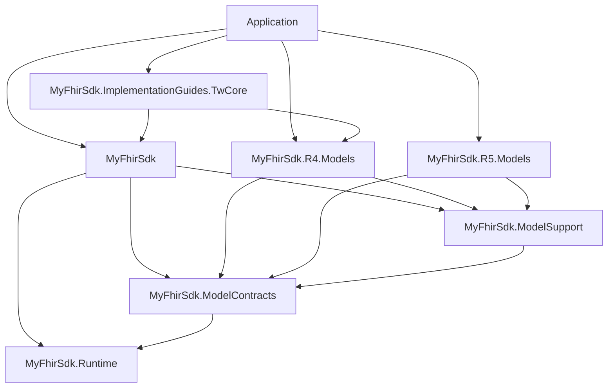

# 目前 SDK 的交付與 API 遷移

本文件適用 D3 之後的 API；歷史 V7／kernel 文件與 frozen consumers 保留原契約。應用程式及其 dependent libraries 須一起重建、publish，部署整份 publish 輸出；不能只換 SDK DLL。

## 組件依賴與選擇

箭頭表示直接依賴；應用程式只選自己使用的 Models，IG 選用。



每組共用四個 DLL：`MyFhirSdk.dll`、`MyFhirSdk.Runtime.dll`、`MyFhirSdk.ModelContracts.dll`、`MyFhirSdk.ModelSupport.dll`。

| 組合 | 額外 DLL | 適用版本 |
| --- | --- | --- |
| R4 | MyFhirSdk.R4.Models.dll | 4.0.1 |
| R5 | MyFhirSdk.R5.Models.dll | 5.0.0 |
| Dual | 兩版 Models | 各自獨立 context |
| R4TwCore | R4 Models、MyFhirSdk.ImplementationGuides.TwCore.dll | R4 三規則 Patient POC |

SDK 不載入未選的 Models，也沒有 R5 fallback。TW Core POC 僅檢查 identifier／system／value 的 presence（包含既有 primitive extension 語意）；沒有載入官方 IG archive 或完整 terminology／FHIRPath 引擎。

## API 遷移

| 舊呼叫／依賴 | 現在的做法 |
| --- | --- |
| 無參數 FhirJsonParser／FhirJsonSerializer／FhirValidator | 傳入明確 FhirModelContext |
| 無參數 FhirResourceTypeResolver | 傳入同一 context |
| R5ModelContext.Default | 使用 R5ModelProvider 的 Metadata／Primitives／Validation 組合 context |
| 非泛型 FhirClient／IFhirClient | FhirClient&lt;TBundle, TOperationOutcome&gt;／IFhirClient&lt;TBundle, TOperationOutcome&gt; |
| 舊 FhirResponseHandler／IFhirResponseHandler | 使用 typed Client；其 response processor 是內部實作 |
| 僅引用 SDK 就取得 R5 models | 明確引用 R5 Models；R4 同理 |
| SDK 內的 TW Core 型別 | 額外引用獨立 TW Core DLL 與 R4 Models |
| 將一般 IFhirValidator 傳入 ProfileValidator | 傳入 IContextualFhirValidator；FhirValidator 已實作 |

R5 的完整基本使用範例見 [repository README](../../README.md)。R4 將 provider 換成 `MyFhirSdk.ModelMetadata.R4.R4ModelProvider`，resource／primitive／datatype namespace 換成 `MyFhirSdk.R4.Resources`、`MyFhirSdk.R4.Primitives`、`MyFhirSdk.R4.Types`。R5 resource namespace 仍為 `MyFhirSdk.Resources`，並非 `MyFhirSdk.R5.Resources`。

Dual 在同一程序建立兩個 context；各版 Client 的 Bundle／OperationOutcome 型別必須與各自 context 相符。Context 會檢查 CLR type 的 ownership，不能混用不同版本的 provider 或模型。

`IFhirValidator.Validate(Resource)` 保留一般驗證用途；`IContextualFhirValidator.Context` 額外讓 ProfileValidator 檢查 IG base version 與 context 是否相符。規則由各版 Models 的 provider 提供，SDK 執行 traversal 與規則、回傳 issues；這不表示會自動下載 StructureDefinition 或遠端 IG。

ProfileValidator 接收 contextual base validator 與 packages。自訂 package 宣告正規的 `FhirVersion`、`SupportedProfiles`、`SupportsProfile`、`SupportsResource`、`GetRules`。不同 validator 可注入同 profile 的不同 package 來替換實作；同一 validator 重複註冊 profile 會拒絕。版本不符在建構時拒絕，未知 profile 依 options 處理。可執行的替換例子見 [IgProbe.cs](../../examples/external/Shared/IgProbe.cs)；自訂 base validator 仍須遵守其 context 的 ownership。

## 新交付與重現

從乾淨、已提交來源執行（輸出目錄須不存在）：

```powershell
python eng/Test-SdkDecouplingD5.py --output artifacts/sdk-decoupling/d5/local
```

預設從目前來源全新 export／pack，再在 repository 外 publish／run 四組 consumer。工具從空 cache 的包內 feed 安裝，兩版重複生成並逐檔符合 committed hashes；四組逐一移除必要 DLL 驗證缺件診斷。IG 正負案例與替換在 R4TwCore 中驗證。這些都是離線測試，不是實際 server 驗收。

也可分開執行：

```powershell
python eng/Export-FhirDelivery.py --composition all --output artifacts/delivery/current
python eng/Test-FhirDelivery.py --bundle artifacts/delivery/current --output artifacts/delivery/current-evidence
python eng/Test-SdkDecouplingD5.py --bundle artifacts/delivery/current --output artifacts/sdk-decoupling/d5/verified
```

單版交付使用 `--composition R4` 或 `R5`；也支援 `Dual`、`R4TwCore`。完整 D5 驗收要求 all 四組。`--tool-package` 可供新 export 使用 canonical nupkg，不能和 D5 的 `--bundle` 同時使用。D5 檢查 bundle revision、來源 fingerprint、dirty flag 必須與目前 checkout 完全一致；舊 bundle 不能替代新來源。

開發中可加 `--allow-working-tree` 驗證未提交內容。即使離線成功，`cleanSourceAcceptance`、D5 status 仍保留 Pending；提交後以乾淨 checkout 重跑才是正式來源證據。`status=Passed` 僅代表 D5 離線 gate，`seriesCloseout` 與 `externalServerAcceptance` 另列，不能據此宣稱 D 系列全數結案。

交付 `bundle/` 整包，保留隱藏的 `.config/`；manifest schema 2 含組合、必要 DLL、版本、實際 assembly identities、工具與 inputs hashes、source revision／fingerprint、全部交付檔案 hashes。將整包複製到 repository 外後，依 [包內 README](../../examples/external/README.md) 執行。不要把 verifier 的 evidence、bin／obj、tool cache 寫回 immutable bundle，也不要混用不同輪的 DLL 或重用同版本工具 cache。

## 實際 server smoke（另行執行）

目前使用者沒有測試環境，R4 與 R5 的實際驗收保留 Pending。日後先確認 endpoint、FHIR 版本、預先存在的 synthetic Patient 與 GET 操作權限。下列入口只執行 `GET metadata` 與 `GET Patient/{id}`，不建立／修改／刪除資料：

```powershell
$env:MYFHIRSDK_R4_INTEGRATION_BASE_URL = 'https://your-r4-server.example/fhir/'
$env:MYFHIRSDK_R4_PATIENT_ID = 'synthetic-patient'
# 有需要才從自己的 secret store 設定 MYFHIRSDK_R4_INTEGRATION_BEARER_TOKEN。
python eng/Test-FhirDeliveryServer.py --bundle artifacts/delivery/current --release R4 --synthetic-patient --output artifacts/delivery/server-r4
```

R5 使用 `--release R5` 與 `MYFHIRSDK_R5_*` 變數，輸出到另一個新目錄。程式先確認 CapabilityStatement 的 `fhirVersion` 精確為 4.0.1／5.0.0，再用 typed Client 讀取 Patient 並核對 ID；404、版本不符、redirect 或讀取失敗皆不算通過。報告綁定 delivery manifest hash、來源及實際 assembly hashes，不記錄 endpoint、Patient、ID 或 token。保留自己的環境設定與執行時間以追溯測試對象。

離線與 server gate 都從同一份 manifest bytes 解析內容、計算 hash，結束前再次核對；即使只改空白，也會拒絕驗收。Server 失敗報告提供 `failureStage`、`errorCode`，子程序非零退出時另記 `processExitCode`。例如 Publish／PublishFailed、MetadataVersion／VersionMismatch、PatientIdentity／PatientMissing；timeout 記為該階段的 Timeout。只保存固定診斷代碼，不保存 child process 原始輸出或遠端錯誤內容。

缺少設定時明確失敗；一般 D5 離線 gate／CI 會清除繼承的 endpoints。受控 HTTP 或本機 stub 測試不取代實際 server 驗收。兩版結果都須來自同一份正式 clean bundle，經 review 核對平台 CI／smoke 證據後才能更新結案狀態。

## 升級與 rollback

升級前保留完整已驗收 bundle、manifest 及 evidence。新來源使用新目錄重新 export／verify，連 dependent libraries 一起重新編譯，整包替換部署。Rollback 使用先前完整 bundle 或隔離 checkout 的 accepted revision 重新 restore／build／test／publish；不混搭新舊 DLL。D4 已保留固定 D3 的完整來源重建回歸。

不回寫 V7／K／D0–D4 baselines，不自動合併 main，不發布 NuGet。公開／私人 NuGet 發布、完整官方 IG、跨版轉換及 terminology／FHIRPath 仍是後續範圍。
