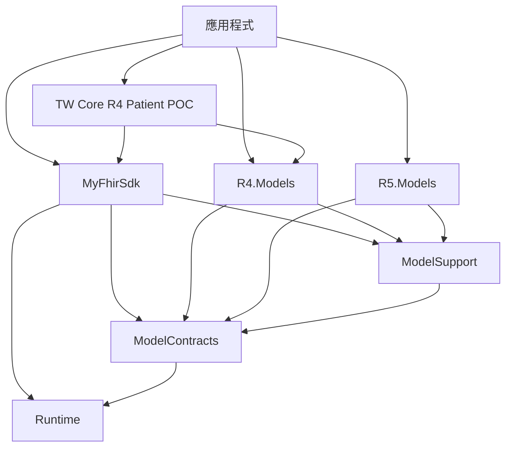

# 設計決策

狀態：提案，依本目錄規劃實作後以驗收結果確認。

## 1. 目標依賴與 ownership

箭頭表示直接依賴；省略 .NET framework assemblies。

應用程式只引用使用的 Models；圖中的 R4／R5 並非都必須部署。IG 是選用功能。不得透過 Support、靜態初始化或反射偷偷載入 R5 Models。

| 組件 | 保留內容 |
| --- | --- |
| Runtime | 既有共用 kernel，不加入版本選擇或 IG 規則 |
| ModelContracts | 中立模型 provider 契約，不引用 SDK 或版本 Models |
| ModelSupport | 共用 codecs／rules，維持無版本 Models 依賴 |
| R4／R5 Models | 各版模型、primitive、provider、composition、SimpleQuantity |
| MyFhirSdk | context、解析／序列化／驗證引擎、typed Client、共用 HTTP、IG 驗證框架 |
| MyFhirSdk.ImplementationGuides.TwCore | 獨立的 R4 Patient 三規則 POC，引用 SDK 與 R4 Models |

TW Core 專案建議放在既有 `ImplementationGuides/TwCore/`，新增 `MyFhirSdk.ImplementationGuides.TwCore.csproj`；主 SDK 必須排除此目錄的預設 Compile glob。僅增加 csproj 而未排除原編譯來源不算拆分完成。

## 2. R5 預設與舊 API 退場

| 目前項目 | 目標 |
| --- | --- |
| Parser／Serializer／Validator 無參數 constructor | 移除；使用明確 context |
| FhirResourceTypeResolver 無參數 constructor | 移除；保留 context 版本 |
| SDK 內 R5ModelContext.Default | 移除；應用程式由 R5ModelProvider 組合 context |
| 非泛型 FhirClient／IFhirClient | 移除；使用 FhirClient<TBundle, TOperationOutcome> |
| 舊 FhirResponseHandler／IFhirResponseHandler | 移除固定回傳 R5 Bundle 的介面與實作 |
| R5ModelMetadataProvider adapter、PrimitiveRegistry.Default 與內部 fallback | 盤點所有引用後移除或改用明確 provider／context |
| SDK 對 Models/R5 的 ProjectReference | 在所有生產引用清除後移除 |

保留通用 executor、HTTP sender、request builder、URI builder、response processor、搜尋及驗證功能。不要因檔名帶有舊 API 名稱就整批刪除：例如非泛型 `FhirHttpException` 沒有引用 R5 Models，而且目前泛型 exception 仍以它保存 HTTP 資訊，應保留共用用途。

`MyFhirSdk.Primitives` namespace 內同時可能有 SDK 的中立執行元件與 R5 model types；判斷依據是型別 defining assembly 與真實引用，不能用 namespace 字串整批禁用或刪除。

不新增相容組件或 type forwarders。這是 source／binary breaking change；應用程式及依賴 libraries 要重新編譯、publish，不支援只替換 SDK DLL。

## 3. Context 與 IG 注入

基礎 `IFhirValidator` 目前只有 `Validate(Resource)`，無法讓 ProfileValidator 確認驗證器使用哪個版本。建議新增 SDK 中立介面 `IContextualFhirValidator : IFhirValidator`，提供唯讀 `FhirModelContext Context`；FhirValidator 實作它。

ProfileValidator 改為接收 IContextualFhirValidator 與注入的 packages。避免同時傳入不相關的 context 和 validator，造成「宣稱 R4、實際以 R5 驗證」的組合。自訂驗證器仍可注入，但要實作該介面並遵守 context 契約；不提供隱含 R5 adapter。此介面名稱與簽名在 D1 固定為 SDK API snapshot。

IG 規則介面與 ProfileValidator 留在 SDK；具體 IG 只透過 constructor 注入。保留明確 profile 驗證與 `meta.profile` 選取能力，不因資源宣告 URL 就自動下載 IG。

建議擴充 IImplementationGuidePackage，以明確方法表達 `(profile URL, resource CLR type)` 是否支援，例如 `SupportsResource(profileUrl, resourceType)`，不能以 GetRules 回傳空集合推論是否支援。支援但沒有額外規則與不支援是不同狀態。

配置與執行規則：

1. 使用正規 FHIR base version `4.0.1`／`5.0.0` 與 context.Identity.FhirVersion 比較；IG 自己的 package version 與 FHIR version 分開。既有 `R4.0.1` 常數在遷移時修正，不默默接受任意格式或近似版本。
2. 注入的 package 與 context 版本不合，建立 ProfileValidator 時即拒絕；不等到 GetRules 回傳空集合。
3. 同一個 ProfileValidator 中，相同 profile URL 被多個 package 宣告時拒絕配置。替換規則時只注入選定的 package，不以參數順序決定勝出者。
4. 資源先通過 context ownership 邊界；已知 profile 但資源型別不適用，回傳明確的 profile error。
5. 未知 profile 沿用 explicit／declared 的設定策略，但不能把已知 profile 的版本／型別錯誤當成未知而 Ignore。
6. 基礎 issues 與適用 IG rules 的 issues 合併，保存 Source、PackageId、ProfileUrl、RuleId。一般基礎 validation issues 不阻止收集適用 IG issues。

本次維持明確 canonical URL 比對，不導入遠端解析或 profile 版本選擇器。若傳入 `url|version`，應明確不支援／診斷，不應悄悄去掉版本再選規則。

## 4. TW Core POC 的版本決策

目前 TwCorePackage 宣告 `R4.0.1`，規則使用 `MyFhirSdk.Resources.Patient`（R5）。不應原封不動搬出後宣稱版本正確。

本規劃建議：在獨立專案把既有三條規則移植到 `MyFhirSdk.R4.Resources.Patient`／相應 R4 types，基礎版本固定 `4.0.1`，以相同的 synthetic cases 驗證行為；正式列為「R4 Patient POC」，不增加官方完整驗證的宣稱。

保留的三條本機 POC 規則是 identifier 至少一項、system 存在、value 存在；RuleId 與 presence／extension 語意需明列測試，不在搬移時任意強化或放寬。package ID／profile URL 的 provenance 在 D0 盤點，現有手寫 ID 不當作已載入官方 package 的證據。

舊 R5 POC 在歷史 revision／baseline 保留；新的 R5 Patient 不得意外套用 R4 規則。若後續確實需要 R5 上的移植規則，應另設身分與獨立驗收，不沿用 R4 package 名義。

獨立專案化仍屬手寫 C# 規則，尚未導入官方 TW Core archive、StructureDefinition compiler、FHIRPath 或 terminology server；這些另案規劃。
